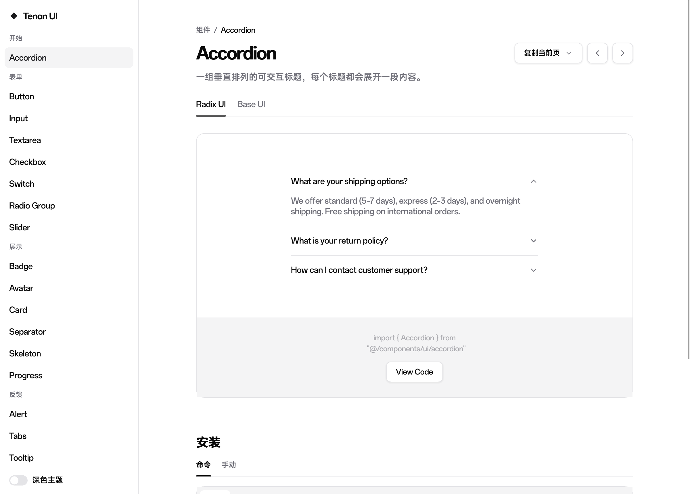

# Tenon

A declarative GUI toolkit for Go, with composable components, reactive data binding, Yoga flexbox layout, and Gio rendering. Build desktop interfaces in ordinary Go using functions for the UI tree and fluent methods for styles and events.

[](https://go.dev/)
[](LICENSE)

**English** | [简体中文](README.zh-CN.md)

[Quick start](#quick-start) · [API guide](#api-guide) · [Examples](#examples) · [Documentation](#documentation) · [Contributing](CONTRIBUTING.md)

## Features

- **Composable UI** — organize layouts with `VStack` / `HStack`, then chain styles and events. Embed `ui.Component` for components with fields and lifecycle context.
- **Reactive values** — connect `Value[T]` and `Bind[T]` directly to text and inputs. Call `Set` to synchronize consumers; extend the interfaces for custom data sources.
- **Function components and hooks** — use `View`, `Use`, `Memo`, and state/effect/context hooks when a function is a better fit.
- **Themed components** — forms, dialogs, menus, tables, and other shadcn/ui-style widgets, with light/dark theme tokens and keyboard interactions.
- **Layout and rendering** — a pure-Go Yoga engine tracking version 3.2.1, Gio rendering, incremental layout, animation, virtual lists, and projected 3D scenes.

## Project status

Tenon is under active development. APIs may change before 1.0. Screen-reader accessibility, bidirectional text, native menus, and multiple windows remain planned work; see the [roadmap](ROADMAP.md) for current capabilities and limitations.

## Quick start

### Requirements

- Go **1.24 or later**.
- Git to clone the examples.
- A desktop session to open a window. Linux also needs the native build dependencies listed in the [development setup](CONTRIBUTING.md#development-setup).

### Run an example

```sh
git clone https://github.com/sjm1327605995/tenon.git
cd tenon
go run ./example/component
```

This example demonstrates an embedded component, its context, and reactive inputs. For the component showcase, run `go run ./example/accordion`.

### Create an application

In a separate directory, initialize a Go module and add Tenon:

```sh
mkdir profile-app
cd profile-app
go mod init example.com/profile-app
go get github.com/sjm1327605995/tenon
```

Save the following as `main.go`:

```go
package main

import (
	"github.com/sjm1327605995/tenon/pkg/shadcn"
	ui "github.com/sjm1327605995/tenon/pkg/ui"
	"github.com/sjm1327605995/tenon/pkg/value"
)

type Profile struct {
	ui.Component
	Name value.Bind[string]
}

func (p *Profile) Render() ui.NodeSource {
	theme := p.Context().Theme()
	return ui.VStack(12,
		ui.Text("Profile").FontSize(22),
		shadcn.TextField(p.Name).Placeholder("Name"),
		ui.Text(p.Name),
		shadcn.TextButton("Clear", func() { p.Name.Set("") }),
	).Width(360).Padding(24).Bg(theme.Card).TextColor(theme.CardForeground)
}

func main() {
	ui.WindowTitle("Tenon — Profile")
	ui.WindowSize(480, 320)
	ui.Run(ui.Render(&Profile{Name: value.New("Tenon")}))
}
```

Start the app:

```sh
go run .
```

Editing the input updates `Name` and the text below it. The button changes the same value through `Set`; the framework manages subscriptions and cleanup.

## API guide

| Need | Start with |
| --- | --- |
| A component with fields and lifecycle context | Embed `ui.Component`, implement `Render() ui.NodeSource`, and mount with `ui.Render(instance)`. Read theme, viewport, effects, and scheduling through `Context()`. |
| Text and input binding | Create persistent data with `value.New(initial)`. Use `ui.Text(source)` and `shadcn.TextField(binding)`; see the [Value / Bind guide](pkg/value/README.md). |
| Function components and local state | Use `ui.View(fn)` or `ui.Use(fn, props)` with hooks; see the [UI API](pkg/ui/README.md). |
| Named fields for layout declarations | Use the optional [struct declaration API](pkg/decl/README.md). It shares the same runtime and can mix with ordinary UI nodes. |

Keep bindings on the component or in another persistent owner rather than creating them on each render. Use `ui.UseValue(source)` when a value controls branches or layout; `Get()` alone reads a snapshot.

UI state runs on the UI thread. From background goroutines, schedule changes with `ui.Post(func() { ... })` or the component context's `Post` method. A component's context is bound when it mounts and canceled when it unmounts.

## Examples

Run these commands from the repository root:

| Example | Command | Demonstrates |
| --- | --- | --- |
| [Component](example/component) | `go run ./example/component` | Embedded component, context, and Value / Bind |
| [Simple](example/simple) | `go run ./example/simple` | Function components, fluent styles, input submission, and lists |
| [Component showcase](example/accordion) | `go run ./example/accordion` | Interactive shadcn-style documentation pages and light/dark themes |
| [Router](example/router) | `go run ./example/router` | Stack navigation with push, pop, and replace |
| [3D cards](example/card3d) | `go run ./example/card3d` | Perspective, a shared camera, and projected images |
| [Struct declarations](example/struct) | `go run ./example/struct` | Optional layouts expressed as Go structs |



## Packages

| Package | Responsibility |
| --- | --- |
| [`pkg/ui`](pkg/ui/README.md) | Components, hooks, elements, styles, layout, input, rendering, and the headless test harness |
| [`pkg/value`](pkg/value/README.md) | Extensible `Value[T]` / `Bind[T]`, static and derived values, and change/validation hooks |
| [`pkg/shadcn`](pkg/shadcn/README.md) | Themed component library built on `pkg/ui` |
| [`pkg/decl`](pkg/decl/README.md) | Optional struct declarations and automatic conversion at component boundaries |
| [`pkg/router`](pkg/router) | Stack navigation, named routes, and route parameters |
| [`pkg/hotreload`](pkg/hotreload) | Yaegi-based live preview and generated interpreter exports |
| [`yoga`](yoga) | Pure-Go flexbox layout engine |

## Documentation

- [Documentation index](docs/README.md) — reading paths, package guides, and historical design material.
- [Architecture](ARCHITECTURE.md) — the Node → Fiber → renderNode model and backend boundaries.
- [Roadmap](ROADMAP.md) — implemented features, limitations, and planned work.
- [API design notes](docs/API_ERGONOMICS.md) — the rationale behind component and binding syntax.
- [Contributing](CONTRIBUTING.md) — environment setup, tests, and contribution guidelines.

## Development

From the repository root:

```sh
go mod download
go build ./...
go vet ./...
go test ./...
go run _debug_snapshot/test_v3.go
```

The last command checks component bounds before and after interactions. Format Go changes with `gofmt`; see [Contributing](CONTRIBUTING.md#testing) for the race detector and Linux display setup.

## License

[MIT](LICENSE).
