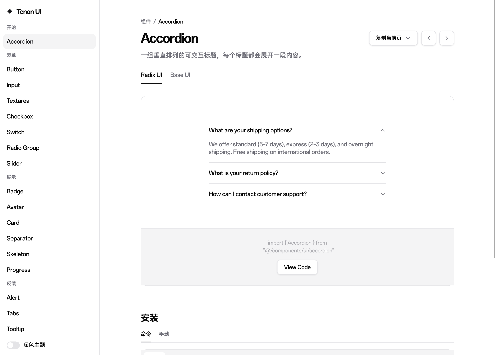

# Tenon

Go 语言的声明式 GUI 工具包，提供可组合组件、响应式数据绑定、Yoga flex 布局和 Gio 渲染。使用普通 Go 代码编写桌面界面：函数组织 UI 树，链式方法设置样式与事件。

[](https://go.dev/)
[](LICENSE)

[English](README.md) | **简体中文**

[快速开始](#快速开始) · [API 选择](#api-选择) · [示例](#示例) · [文档](#文档) · [参与贡献](CONTRIBUTING.md)

## 特性

- **组件组合**：用 `VStack` / `HStack` 组织布局，链式添加样式与事件；需要字段和生命周期上下文时，内嵌 `ui.Component`。
- **响应式数据**：将 `Value[T]`、`Bind[T]` 直接交给文本与输入框，调用 `Set` 同步界面；自定义数据源可通过实现接口接入。
- **函数组件与 Hooks**：支持 `View`、`Use`、`Memo`，以及状态、副作用、上下文等 Hooks。
- **主题组件**：提供表单、对话框、菜单、表格等 shadcn/ui 风格控件，以及明暗主题令牌与键盘交互。
- **布局与渲染**：纯 Go Yoga 引擎对齐 3.2.1，配合 Gio 渲染，支持增量布局、动画、虚拟列表和 3D 投影场景。

## 项目状态

Tenon 正在持续开发，1.0 之前 API 可能调整。Gio 已提供基础无障碍语义，普通文本、输入框和 RichText 支持双向文字映射；完整双向文字与屏幕阅读器工作流和原生菜单仍属于待办。当前能力和限制以[路线图](ROADMAP.md)为准。

## 快速开始

### 环境要求

- Go **1.24 或更高版本**。
- Git，用于克隆示例。
- 可打开窗口的桌面环境。Linux 还需安装[开发环境说明](CONTRIBUTING.md#development-setup)中的原生构建依赖。

### 运行示例

```sh
git clone https://github.com/sjm1327605995/tenon.git
cd tenon
go run ./example/component
```

这个示例展示内嵌组件、Context 与响应式输入。查看组件展示页可运行 `go run ./example/accordion`。

### 创建应用

在独立目录中初始化 Go 模块并添加依赖：

```sh
mkdir profile-app
cd profile-app
go mod init example.com/profile-app
go get github.com/sjm1327605995/tenon
```

将以下代码保存为 `main.go`：

```go
package main

import (
	"github.com/sjm1327605995/tenon/pkg/shadcn"
	ui "github.com/sjm1327605995/tenon/pkg/ui"
	"github.com/sjm1327605995/tenon/pkg/value"
)

type Profile struct {
	ui.Component
	Name value.Bind[string]
}

func (p *Profile) Render() ui.NodeSource {
	theme := p.Context().Theme()
	return ui.VStack(12,
		ui.Text("个人资料").FontSize(22),
		shadcn.TextField(p.Name).Placeholder("姓名"),
		ui.Text(p.Name),
		shadcn.TextButton("清空", func() { p.Name.Set("") }),
	).Width(360).Padding(24).Bg(theme.Card).TextColor(theme.CardForeground)
}

func main() {
	ui.WindowTitle("Tenon — 个人资料")
	ui.WindowSize(480, 320)
	ui.Run(ui.Render(&Profile{Name: value.New("Tenon")}))
}
```

启动应用：

```sh
go run .
```

编辑输入框会更新 `Name` 和下方文本；按钮通过 `Set` 修改同一个值。框架负责订阅与清理。

## API 选择

**默认推荐**：应用页面和需要字段、生命周期的组件使用内嵌 `ui.Component`；无对象字段的可复用组件使用函数组件与 Hooks。结构体声明是可选语法，不建议在同一个组件边界混用多种组件身份。

| 场景 | 推荐入口 |
| --- | --- |
| 组件需要字段与生命周期上下文 | 内嵌 `ui.Component`，实现 `Render() ui.NodeSource`，通过 `ui.Render(instance)` 挂载；用 `Context()` 获取主题、窗口尺寸、副作用与调度能力。 |
| 文本与输入框绑定 | 用 `value.New(initial)` 创建持久数据，传给 `ui.Text(source)`、`shadcn.TextField(binding)`；详见 [Value / Bind 指南](pkg/value/README.md)。 |
| 函数组件与局部状态 | 使用 `ui.View(fn)` 或 `ui.Use(fn, props)`，配合 Hooks；详见 [UI API](pkg/ui/README.md)。 |
| 希望通过具名字段声明布局 | 使用可选的[结构体声明 API](pkg/decl/README.md)，与普通 UI 节点共用运行时并可混用。 |

将绑定值保存在组件字段或其他持久对象中，避免每次渲染时重新创建。值参与分支、布局计算时，用 `ui.UseValue(source)` 读取并订阅；单独调用 `Get()` 只读取快照。

UI 状态在 UI 线程中读写。后台 goroutine 通过 `ui.Post(func() { ... })` 或组件 Context 的 `Post` 方法调度更新。组件挂载后才能获取 Context，卸载时其生命周期自动取消。

## 可选 G3N 游戏后端

默认渲染后端仍是 Gio。需要完整 3D 游戏场景时，可导入独立的 [`backend/g3n`](backend/g3n) 模块，由 G3N 提供场景、网格、模型、灯光、物理和音频，Tenon 负责声明式 UI：

```go
g3n.Use(g3n.Options{Launch: func(game *g3n.Game) {
    // 使用 G3N 原生 API 创建游戏场景。
}})
ui.Run(ui.Text("Tenon UI on G3N"))
```

主模块不依赖 G3N；适配层不需要额外资源包或链接参数。`GameScene` 提供声明式 Camera、Mesh/Sphere/Cube、Material、Light 和 Transform 组件，支持资源共享、`value.Value` 属性绑定与 Spin 动画。`Scene3DPluginRegistry` 让内建组件和第三方插件共用统一生命周期；`Plugin3DVersion` 与 `RegisterPluginVersion` 精确匹配插件版本，可选 `Scene3DValidator` 在原生资源分配前校验 payload，`SupportsPlugin` 查询注册能力，未版本化的 `Plugin3D` 继续可用。构建、原生 3D 与插件示例见[后端说明](backend/g3n/README.md)。

## 示例

在仓库根目录运行：

| 示例 | 命令 | 内容 |
| --- | --- | --- |
| [快速开始](example/quickstart) | `go run ./example/quickstart` | 与上方完整应用相同的个人资料示例 |
| [组件与绑定](example/component) | `go run ./example/component` | 内嵌 Component、Context、Value / Bind |
| [简洁写法](example/simple) | `go run ./example/simple` | 函数组件、链式样式、输入提交与列表 |
| [组件展示](example/accordion) | `go run ./example/accordion` | 可交互的 shadcn 风格文档页与明暗主题 |
| [路由](example/router) | `go run ./example/router` | Push、Pop、Replace 栈式导航 |
| [双向文字](example/bidi) | `go run ./example/bidi` | Hebrew、Arabic、RichText 与输入框 |
| [渐变与滤镜](example/gradient) | `go run ./example/gradient` | 渐变、圆角裁剪、图片模糊与灰度 |
| [版本化插件](example/plugin) | `go run ./example/plugin` | 公开插件校验、精确版本匹配与关闭/重挂载生命周期，无原生依赖 |
| [组件目录](example/catalog) | `go run ./example/catalog` | 全部主要组件的可滚动、可操作目录 |
| [多窗口](example/multiwindow) | `go run ./example/multiwindow` | 独立输入、IME、剪贴板与窗口生命周期 |
| [3D 卡片](example/card3d) | `go run ./example/card3d` | 透视、共享相机与图片投影 |
| [结构体声明](example/struct) | `go run ./example/struct` | 使用 Go 结构体声明布局的可选写法 |



## 包结构

| 包 | 职责 |
| --- | --- |
| [`pkg/ui`](pkg/ui/README.md) | 组件、Hooks、元素、样式、布局、输入、渲染和无头测试工具 |
| [`pkg/value`](pkg/value/README.md) | 可扩展的 `Value[T]` / `Bind[T]`、静态与派生值、变化和校验钩子 |
| [`pkg/shadcn`](pkg/shadcn/README.md) | 基于 `pkg/ui` 的主题组件库 |
| [`pkg/decl`](pkg/decl/README.md) | 可选的结构体声明与组件边界自动转换 |
| [`pkg/router`](pkg/router) | 栈式导航、具名路由和路由参数 |
| [`pkg/hotreload`](pkg/hotreload) | 基于 Yaegi 的实时预览与解释器导出 |
| [`backend/g3n`](backend/g3n) | 可选 G3N 游戏后端，独立 Go module，不影响默认 Gio |
| [`yoga`](yoga) | 纯 Go flex 布局引擎 |

## 文档

- [文档索引](docs/README.md)：阅读路径、各包指南和历史设计资料。
- [架构](ARCHITECTURE.md)：Node → Fiber → renderNode 模型与渲染后端边界。
- [后端与平台支持](docs/PLATFORM_SUPPORT.md)：能力矩阵、已执行验证与待验证项目。
- [路线图](ROADMAP.md)：已实现功能、限制与后续计划。
- [变更记录](CHANGELOG.md)与[发布指南](docs/RELEASING.md)：公开变更与发布验收门槛。
- [API 设计说明](docs/API_ERGONOMICS.md)：组件与数据绑定写法的设计依据。
- [贡献指南](CONTRIBUTING.md)：环境搭建、测试与贡献流程。

## 本地开发

在仓库根目录执行：

```sh
go mod download
go build ./...
go vet ./...
go test ./...
go run _debug_snapshot/test_v3.go
```

最后一条命令检查交互前后的组件 bounds。Go 代码使用 `gofmt` 格式化；竞态检测与 Linux 显示环境配置见[贡献指南](CONTRIBUTING.md#testing)。

## 许可证

[MIT](LICENSE)。
